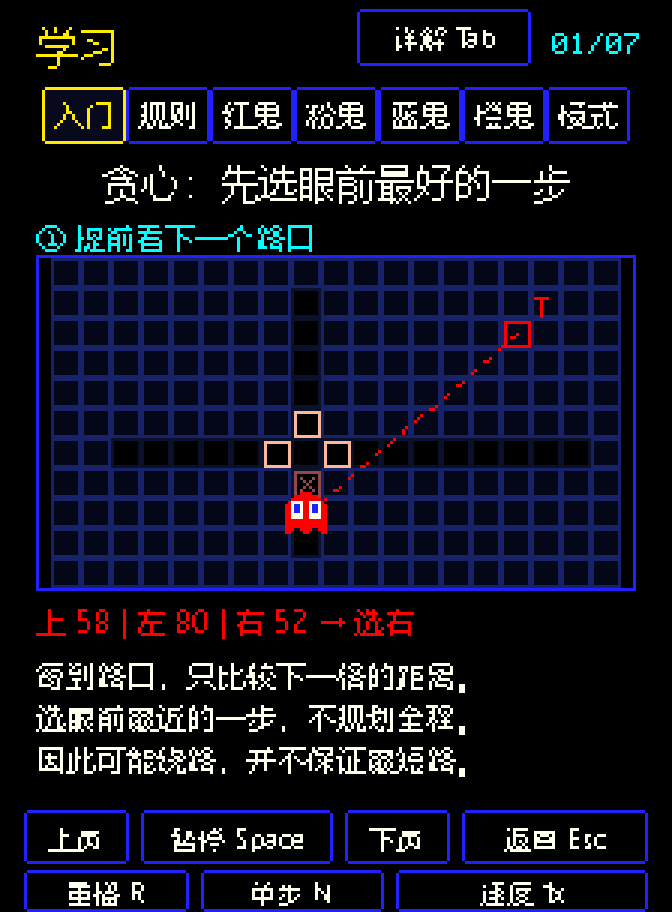
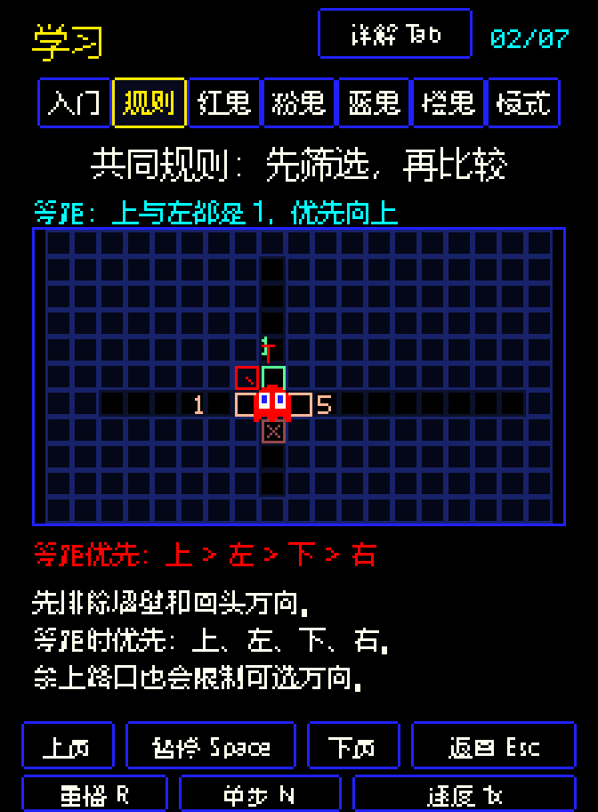
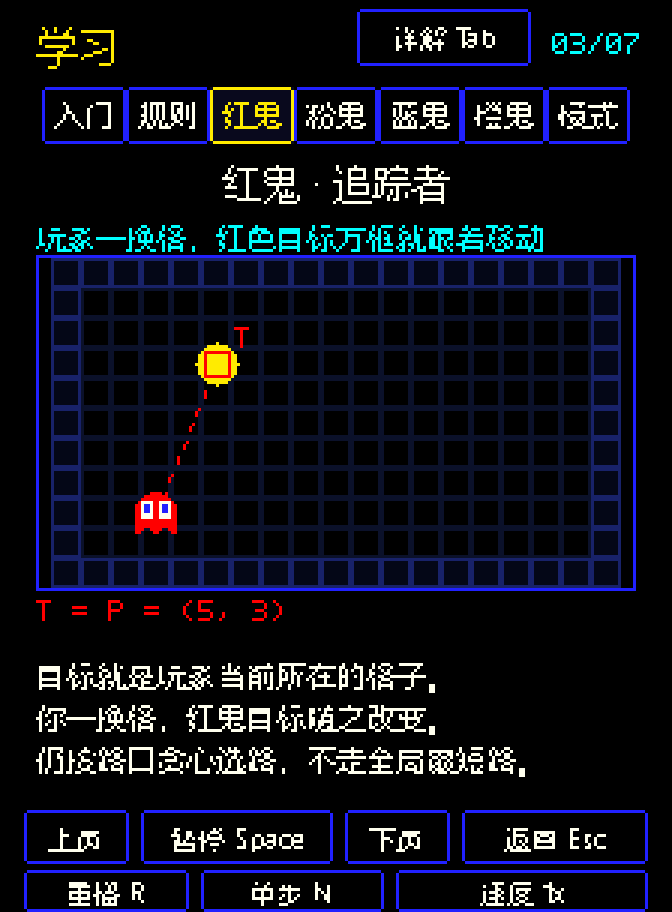
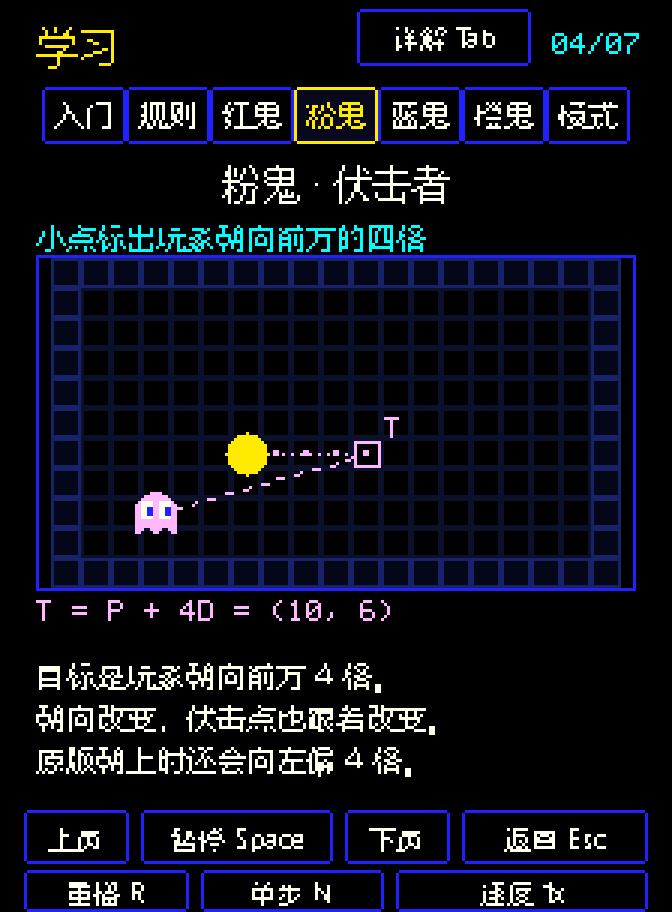
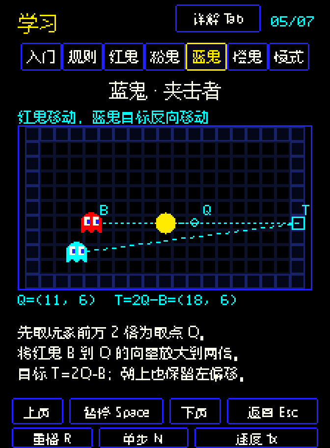
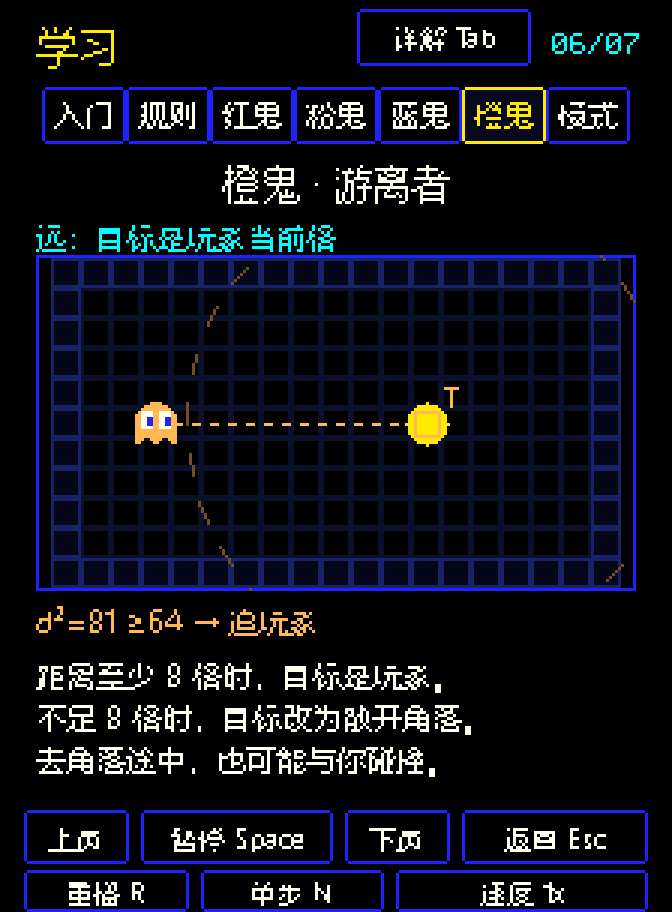
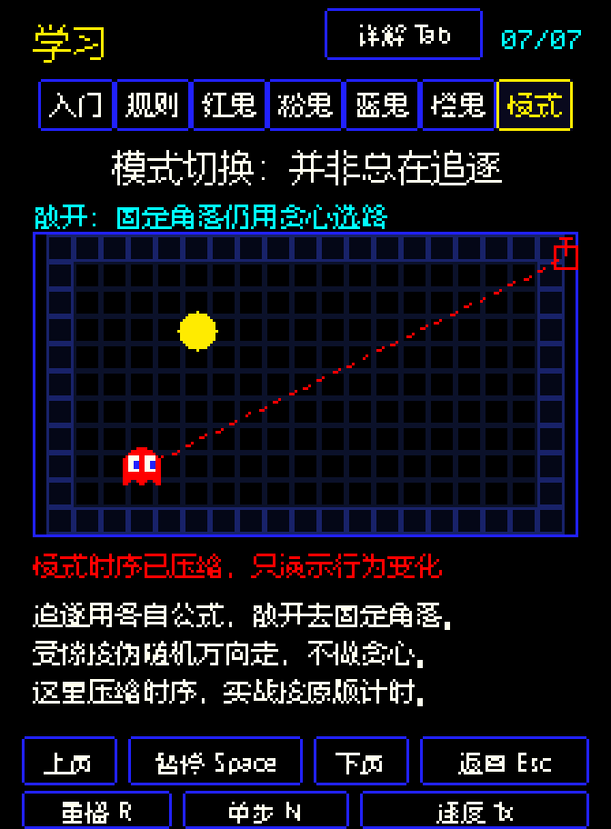

# 吃豆人的贪心选路与四鬼策略

在游戏开始页点击“学习贪心算法”，或按 L。每章可播放、暂停、单步、调速，也能按 Tab 阅读详解。下面的 GIF 是同一学习界面的导出版本，自动循环播放。

## 1. 贪心算法：先选眼前最好的一步

鬼到路口时，比较各个可走方向的下一格到目标格的距离，选择最小值。它使用平方距离：

`d² = (x - Tx)² + (y - Ty)²`

示例中，上、左、右分别是 58、80、52，所以向右。下方是来路，先排除。这种局部选择没有规划整条路线，可能绕路，也不保证找到全局最短路径。

## 2. 四鬼共用的选路规则

先排除墙壁和主动回头方向，再比较距离；等距时按“上、左、下、右”选择。特殊禁上路口还会限制正常模式的向上转向。鬼提前一格计划下一个路口的方向，目标格可以在墙里或地图外。

四鬼主要区别在于**目标格怎样产生**，并非四套完全不同的路径算法。

## 3. 红鬼：追踪者

追逐目标是玩家当前所在格：`T = P`。玩家换格，目标随之更新，红鬼逐路口靠近这个目标。

普通散开时它去右上角；进入 Cruise Elroy 加速阶段后，散开时段也继续以玩家为目标。

## 4. 粉鬼：伏击者

目标是玩家朝向前方 4 格：`T = P + 4D`。朝向变了，伏击点也改变。

保留原版朝上偏移：朝上时实际目标既向上 4 格，也向左 4 格。动图里的灰叉是没有该错误时的理想取点，粉色方框才是真正目标。

## 5. 蓝鬼：夹击者

先取玩家前方 2 格的 Q，读取红鬼所在格 B，再把向量 B→Q 放大到 2 倍：

`T = B + 2(Q - B) = 2Q - B`

Q 是 B 与 T 的中点，B→Q 和 Q→T 等长同向。空心圆表示 Q，空心方框表示 T；所有关联线保持蓝鬼颜色。固定玩家、移动红鬼，可以看到目标朝相反方向移动。朝上时 Q 也保留向左偏移 2 格的错误。

## 6. 橙鬼：游离者

距离玩家**至少 8 格**时追玩家；不足 8 格时改去左下散开角落。比较式为 `d² ≥ 64` 与 `d² < 64`，恰好 8 格仍追逐玩家。

虚线圆表示 8 格阈值。切换目标不会让橙鬼立即掉头或变得无害，去角落途中仍可能撞到玩家。

## 7. 并非总在贪心追逐

追逐时使用各自的目标公式；散开时通常用固定角落；受惊时按伪随机方向尝试出口，没有固定的贪心目标。受惊期间暂停模式计时，结束时不反向。

动画把模式时序压缩为 8 秒循环，实战仍使用项目中的关卡计时表。

学习场景是突出关键变量的示意棋盘，移动按教学速度简化。目标公式与方向比较直接复用 `pacman/rules.py`。原版行为背景可参阅 [The Pac-Man Dossier](https://pacman.holenet.info/)；本项目与 ROM 逐帧模拟的区别见项目 README。
